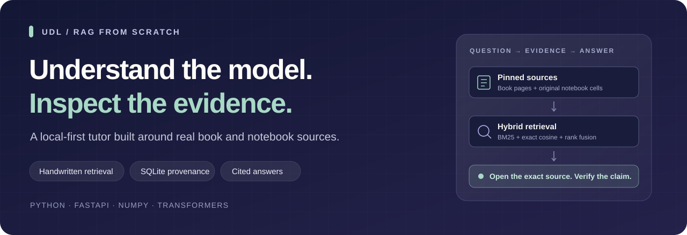
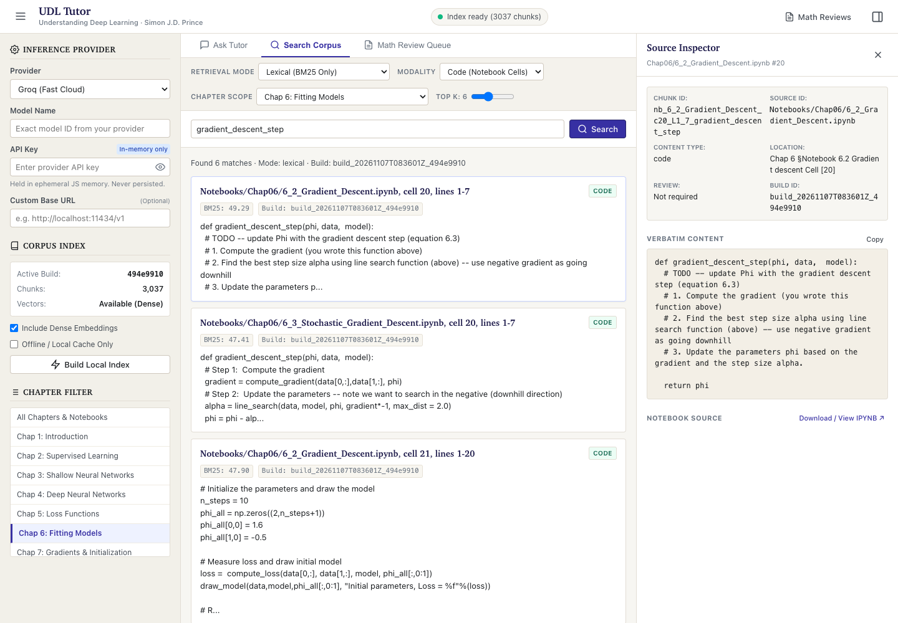
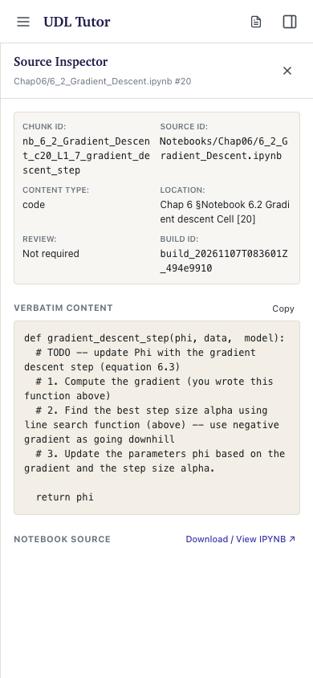
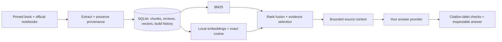

<p align="center">
  
</p>

<p align="center">
  <a href="https://github.com/manyakaistha/understanding-deep-learning-rag/actions/workflows/ci.yml"></a>
  
  
  
  <a href="LICENSE"></a>
  <a href="https://github.com/manyakaistha/understanding-deep-learning-rag/releases"></a>
</p>

<p align="center"><a href="#see-it-in-action">Screenshots</a> · <a href="#quickstart">Quickstart</a> · <a href="#built-from-first-principles">Engineering</a> · <a href="#evaluation-and-current-limits">Evaluation</a> · <a href="CONTRIBUTING.md">Contributing</a></p>

# Understanding Deep Learning · RAG from scratch

**Ask about the theory. Find the assignment code. Open the evidence.**

A local-first study companion for Simon Prince’s [*Understanding Deep Learning*](https://udlbook.github.io/udlbook/) and its official chapter notebooks. It connects book explanations, Python cells, figures, exercises, and mathematical source regions through an inspectable retrieval pipeline.

The RAG algorithms are handwritten: **BM25, exact cosine search, reciprocal rank fusion, context assembly, and citation-label validation**. SQLite is the persistent store. No LangChain, LlamaIndex, hosted vector database, or vector-search extension is required.

> **Public beta:** usable for exploration and study, with known retrieval gaps. Search needs no API key. Book files and model weights are obtained locally, not bundled in this repository. Mathematical transcriptions require local review; see [source boundaries](docs/SOURCES.md).

## See it in action



*Real interface, real notebook retrieval: chapter filters, lexical scores, source identities, and the original assignment cell. Notebook content shown is © Simon Prince, MIT-licensed. Screenshots use a locally indexed development corpus.*

<details>
<summary><strong>Mobile source inspection</strong></summary>
<br>

</details>

## What you can do

- **Search book and code together.** Retrieve explanations and their corresponding notebook implementations, with chapter and modality filters.
- **Inspect every source.** Open the exact PDF page, notebook cell and line span, or extracted source crop behind a result.
- **Choose your answer model.** Use Groq, Gemini, an OpenAI-compatible endpoint, or local Ollama. Changing providers does not re-embed the corpus.
- **Study without hidden execution.** Assignment TODOs remain original templates. Generated code is labeled as derived and unexecuted.
- **Rebuild safely.** Stage updates atomically, reuse unchanged vectors, preserve immutable source snapshots, and retain a working index after failed builds.

## Quickstart

Requires **Python 3.10–3.13**, [uv](https://docs.astral.sh/uv/getting-started/installation/), and Git. Python 3.12 is used in CI.

```bash
git clone https://github.com/manyakaistha/understanding-deep-learning-rag.git
cd understanding-deep-learning-rag
uv sync --locked
uv run python -m src.cli build
uv run python -m src.cli serve
```

Open **http://127.0.0.1:8000** and select **Lexical** in Search Corpus. The first build explicitly downloads the checksum-pinned book and commit-pinned notebooks. It needs network access and disk space; it does not call paid answer APIs or execute notebooks. Later runs can start directly with `serve`.

### Add semantic search

```bash
uv sync --locked --extra semantic
uv run --extra semantic python -m src.cli build --semantic
uv run --extra semantic python -m src.cli serve
```

This downloads the pinned `Qwen/Qwen3-Embedding-0.6B` checkpoint and builds local dense vectors. CPU inference is supported; the first build can take time. PyTorch and Transformers are optional, so the default install stays lightweight. If dense search is unavailable, Hybrid reports a lexical fallback; Semantic mode reports an actionable error.

### Chat with a local model

Install and start [Ollama](https://ollama.com/), then:

```bash
ollama pull qwen3:8b
```

In the app, choose **Ollama** and enter **qwen3:8b** as the model. To ask through the CLI after a lexical build:

```bash
uv run python -m src.cli ask "What does gradient descent update?" \
  --mode lexical --provider ollama --model qwen3:8b
```

For remote models, select a provider and enter an exact model ID and your own key. Browser keys and chat history stay in page memory. Requests send the question, bounded history, and selected excerpts to the chosen provider. CLI keys use environment variables; see [`.env.example`](.env.example). Environment files are not loaded automatically.

## Built from first principles

| Engineering area | Implementation | Why it matters |
| --- | --- | --- |
| Source-faithful extraction | PyMuPDF geometry, AST-aware notebook partitioning, stable chunk IDs | Code statements, TODOs, source spans, and mathematical regions remain inspectable. |
| Lexical retrieval | Identifier-aware tokenization and handwritten BM25 | Finds symbols, exact references, and terminology without model weights. |
| Dense retrieval | Direct Transformers/PyTorch inference, last-token pooling, L2 normalization, NumPy cosine | One shared space for prose and code; no vector-service dependency. |
| Hybrid ranking | Reciprocal rank fusion, explicit anchors, source-scoped compound questions | Connects book reasoning to notebook evidence without treating fusion scores as confidence. |
| Grounded generation | Bounded complete-source context, source-label checks, one repair attempt, abstention | Catches missing or invented citation labels and exposes evidence for human review. |
| Data lifecycle | SQLite WAL, staged activation, content fingerprints, vector reuse, immutable snapshots | Makes incremental rebuilds, provenance, and recovery explicit. |

**Low-level libraries are used where appropriate.** PDF parsing, HTTP, numerical arrays, neural-model inference, and web serving are delegated to maintained libraries; the retrieval and orchestration logic is implemented here.



[Read the architecture →](docs/ARCHITECTURE.md)

## Corpus and provenance

The pinned reference corpus extracts **3,037 chunks** from **69 chapter notebooks and one book**:

| Prose | Notebook code | Notebook Markdown | Display-math regions | Figures | Exercises | Algorithms |
| ---: | ---: | ---: | ---: | ---: | ---: | ---: |
| 676 | 910 | 467 | 500 | 285 | 197 | 2 |

PDF pages and printed book pages are distinguished. Notebook cell indices are zero-based; line spans are one-based. Identical content at different source locations keeps separate identities.

The public distribution includes the engine and review workflow, **not the book, extracted pages, or the development transcription bundle**. On a fresh build, mathematical regions remain pending until locally transcribed and compared with their source crops. Pending mathematics is excluded from trusted answer context; the original source remains available for inspection. A usable index is separate from a fully validated corpus.

## Evaluation and current limits

The reference implementation was evaluated on a fixed **100-question** suite with source-page/cell assertions, multi-evidence cases, and unsupported questions.

| Reference-build check | Result |
| --- | ---: |
| Development supported Hit@5 | **51/54 · 94.44%** |
| Broader regression supported Hit@5 | **27/36 · 75.00%** |
| Unsupported-question abstention, broader split | **4/4 · 100%** |
| Citation resolution, broader split | **100%** |

These retrieval results are from the locally reviewed development corpus. The transcription bundle and dense index used there are **not** distributed, so they are not an out-of-the-box score for this public beta. The broader split was inspected during debugging and is now regression evidence, not an untouched holdout. Theory and figure recall remain below the release target; `release_ready` stays false until the actual gates pass.

Citation resolution checks source identity, **not whether every generated claim follows from that source**. Inspect the evidence. Remote provider adapters are fixture-tested; live generation was checked locally with Ollama `qwen3:8b`. The app does not run generated code or notebooks.

[Evaluation protocol and limitations →](docs/EVALUATION.md)

## Run the checks

```bash
uv sync --locked
uv run python -B -m unittest discover -s tests -v
node src/static/tests/run_tests.js
node --check src/static/app.js
uv lock --check
```

The lightweight suite runs without API keys, book downloads, or model weights. Real-source extraction and benchmark-fidelity suites skip when their pinned data is absent; the optional real-encoder smoke check is opt-in. Node.js 22 is used for frontend checks.

After building locally:

```bash
uv run python -m src.cli doctor
uv run python -m src.cli review --pending
uv run --extra semantic python -m src.cli evaluate --mode hybrid --split heldout \
  --output data/evaluation/release.json
```

## Project map

```text
src/
  corpus.py                 # pinned acquisition and faithful extraction
  store.py                  # SQLite schema, staged builds, provenance, recovery
  dense.py                  # encoder inference, pooling, windows, cache identity
  search.py                 # BM25, cosine, rank fusion, evidence selection
  tutor.py / providers.py   # context, direct HTTP adapters, citation-label checks
  cli.py / web.py           # shared runtime through CLI and localhost API
  static/                   # buildless UI, local Markdown/math/code assets
tests/                      # deterministic fixtures and optional source/model checks
resources/evaluation.json   # fixed source-aware benchmark
docs/                       # architecture, evaluation, attribution, screenshots
```

## Roadmap

- Improve theory and figure recall without weakening source-fidelity or abstention checks.
- Add new, independently authored evaluation cases before further ranking changes.
- Expand live provider verification and reduce model-specific citation-repair failures.
- Improve the local mathematical review workflow and accessibility coverage.

## Sources, license, and attribution

Created by [Manya Kaistha](https://github.com/manyakaistha).

This independent project accompanies Simon J.D. Prince’s *Understanding Deep Learning* (MIT Press). It is not an official book product. The [official book](https://udlbook.github.io/udlbook/) and [official notebooks](https://github.com/udlbook/udlbook) remain the authoritative learning resources.

Application code is released under **[AGPL-3.0-or-later](LICENSE)**. Book content is separately licensed **CC BY-NC-ND 4.0**; official notebooks are **MIT-licensed**. Frontend vendors and fonts retain their own notices. These terms do not become AGPL merely because the app can retrieve the material. See [NOTICE](NOTICE.md) and [source boundaries](docs/SOURCES.md).
